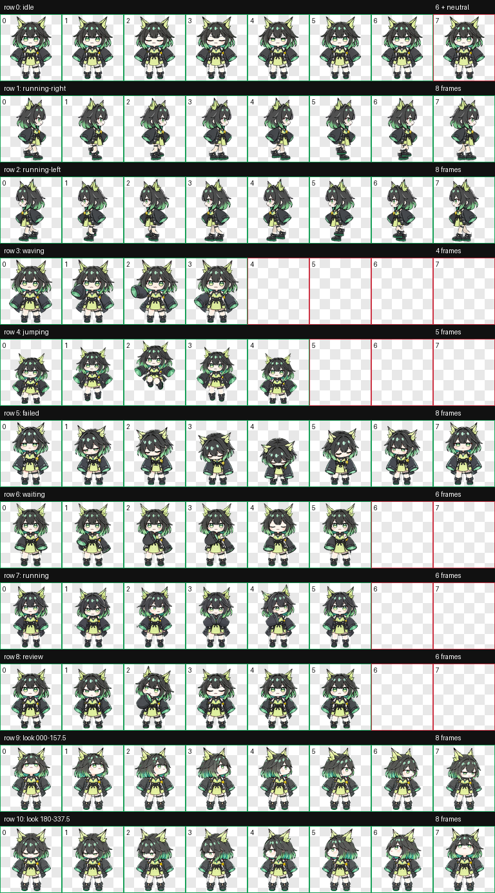

# Mon3tr for Codex

以《明日方舟》中的 Mon3tr 为原型制作的非官方 Codex 桌宠。包含透明背景的 v2 动画图集、走路动画预览和可编辑的逐帧素材工具。



## 安装

将 [`pet/m3`](pet/m3) 文件夹复制到 Codex 的宠物目录：

```text
Windows: %USERPROFILE%\.codex\pets\m3\
macOS / Linux: ~/.codex/pets/m3/
```

该文件夹中应直接包含 `pet.json` 与 `spritesheet.webp`。然后在 Codex 中选择 **Mon3tr**。`id` 保留为 `m3`，方便已有安装直接更新显示名称。

## 动画

- 图集尺寸：1536 × 2288，8 列 × 11 行，每格 192 × 208。
- 包含待机、左右行走、挥手、跳跃、失败、等待、工作、检查，以及 16 个注视方向。
- 左右行走各有 8 个姿势，脚底为深绿色。待机第 8 格复制了安静待机画面，用于避免偶发空白闪烁。
- 播放速度由 Codex 应用决定；本仓库中的宠物配置不提供 FPS 设置。

 

## 修改素材

安装 Python、Pillow 和 NumPy：

```sh
python -m pip install -r requirements.txt
```

把图集拆成 PNG 帧、编辑后重新合成：

```sh
python scripts/atlas.py extract
python scripts/atlas.py build
```

拆出的帧位于 `frames/`；合成结果覆盖 `pet/m3/spritesheet.webp`。`art-source/spritesheet-strict.webp` 是遵循空白格规范的版本。安装用图集在待机第 8 格增加了防闪烁备用帧。`scripts/rig_walk.py` 和 `art-source/rig-source.png` 提供了双脚行走姿势的制作来源；`python scripts/rig_walk.py` 可以重新生成供逐帧编辑参考的 `art-source/running-right-strip.png`。

## 授权

仓库中由本项目制作的代码和图像以 [MIT 许可证](LICENSE) 开源。本项目与《明日方舟》官方无关；《明日方舟》及 Mon3tr 的角色设定、名称和商标权利仍归其各自权利人所有。
